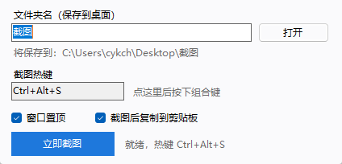
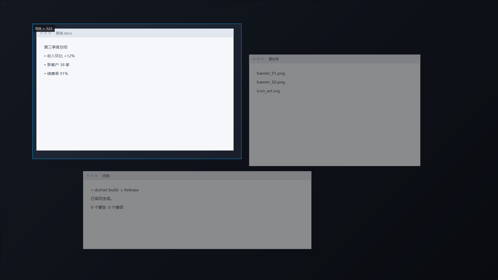

# ShotTool · 截图工具

> 一个 **51 KB** 的 Windows 截图小工具：常驻小窗、全局热键、单击全屏 / 拖动框选，截完直接进桌面上的指定文件夹。


A tiny Windows screenshot utility in a single 51 KB executable — global hotkey, click for full screen, drag for a region, and every shot lands directly in a folder on your Desktop. No editor, no cloud, no runtime install.



按热键后屏幕冻结，拖动框选，松开即存：



## 为什么又做一个

现有工具要么功能很全但很重（截图 + 标注 + 贴图 + 云同步），要么截完还得手动挑目录另存。这个工具只做一件事：**按热键 → 框一下 → 图片已经在桌面文件夹里了**。

- 不画箭头、不打码、不贴图 —— 那些交给 Snipaste
- 不弹保存对话框 —— 目录提前设好，静默落盘
- 不装运行库 —— Win10/11 自带 .NET Framework 4.8

## 功能

- **单击 / 拖动两种截法**：按热键后冻结整屏，单击截光标所在那台显示器，拖动截矩形，松开立即保存
- **全局热键 + 真实冲突检测**：默认 `Ctrl+Alt+S`，改键时用临时 id 真注册一次，被占用会明确报错且**保留旧键**
- **文件夹名随手改**：在桌面下创建同名文件夹，非法字符 / Windows 保留名会被拦下
- **窗口置顶可关**：默认置顶，取消后正常参与层叠
- **托盘常驻**：关窗即收进托盘，热键继续有效
- **失败不丢图**：保存失败时图片留在内存，可另存为或复制到剪贴板
- **零依赖**：单个 exe，双击即用

## 使用

1. 双击 `ShotTool.exe`
2. 填文件夹名（默认 `截图`），窗口会实时显示完整保存路径
3. 按 `Ctrl+Alt+S`，或点「立即截图」
4. **单击** = 截光标所在屏幕，**拖动** = 框选区域，`Esc` / 右键 = 取消
5. 图片存到 `桌面\<名字>\ScreenShot_20261025_201433_508.png`，同时复制到剪贴板

改热键：点热键框 → 直接按下新组合 → 立即生效，不用重启。

## 热键冲突检测

从便宜到昂贵四层，逐层收紧：

| 层 | 做法 | 能发现 |
|---|---|---|
| 1. 结构 | 是否只有修饰键、是否系统保留键（`Alt+Tab`、`Win+L`…） | 明显无效的组合 |
| 2. 试注册 | 用临时 id 调 `RegisterHotKey`，成功立刻注销 | 其他程序已占用（Win32 `1409`） |
| 3. 换键 | 注销旧键 → 注册新键；失败立刻回滚旧键 | 探测与注册之间被抢的竞态 |
| 4. 经验表 | QQ / 微信 / 钉钉 / 飞书 / Snipaste / 系统截图 / NVIDIA… | 常见冲突，只提示不拦截 |

**检测不到的情况**（如实说明）：

- Windows 不会告诉你是谁占用的，只能告诉你「被占了」
- 用底层钩子 / RawInput 抢键的程序（部分游戏、输入法、宏工具），注册会成功但按下没反应
- 输入法切换键（`Ctrl+Space` 等）冲突时表现不稳定

启动时如果热键已被占用：本次自动退到 `Alt+S` → `Ctrl+Shift+S` → `Alt+X`，**不覆盖你保存的设置**，等占用它的程序退出后，下次启动会自动回到原键。

## 图片存在哪

目标目录 = **桌面** + 你填的文件夹名。桌面路径运行时探测，按顺序停在第一个可用项：

1. 外壳 API `DesktopDirectory` —— 跟随 OneDrive「备份桌面」、域漫游、组策略重定向
2. 外壳 API `Desktop`
3. 注册表 `HKCU\...\Explorer\Shell Folders\Desktop`
4. `%USERPROFILE%\Desktop`
5. `%LOCALAPPDATA%\ShotTool\Screenshots`（兜底，保证不丢图）

窗口里「将保存到」显示的就是这次实际命中的路径，换电脑 / 换账户自动重新解析。

**文件夹名规则**：禁止 `\ / : * ? " < > |`、控制字符、结尾的点；禁止 `CON` `PRN` `AUX` `NUL` `COM1-9` `LPT1-9`；最多 80 字符；中文和空格可用。

## 安装

- 到 [Releases](../../releases) 下载 `ShotTool-1.0.0-win.zip`，解压后双击 `ShotTool.exe`
- 或者自行构建（见下）
- 需要 Windows 10 1903+ / Windows 11
- exe 未签名，首次运行 SmartScreen 会提示一次：**更多信息 → 仍要运行**

## 从源码构建

```bash
git clone https://github.com/<you>/ShotTool.git
cd ShotTool
dotnet build ShotTool.csproj -c Release
# 产物：bin/Release/net48/ShotTool.exe
```

- 需要任意 .NET SDK（6 及以上）
- `net48` 的引用程序集通过 NuGet 自动还原，**不需要装 Visual Studio**
- 重新生成图标：编译并运行 `tools/MakeIcon.cs`

## 自检

```bash
ShotTool.exe --selftest
```

在同目录生成 `selftest.log`，27 项检查：

- 桌面目录解析（会打印命中的来源，如 `Shell.DesktopDirectory`）
- 桌面可写入（失败通常是环境限制，见 FAQ）
- 文件夹名校验：空名 / 斜杠 / 双点 / `CON` / `NUL.txt` / 结尾点 / 问号 ……
- 配置读写往返
- 抓屏尺寸与虚拟屏幕一致、PNG 编码回读、同毫秒连拍不覆盖
- 热键注册、重复注册拿到 `1409`、注销后恢复空闲、保留键识别

`RESULT: PASS` 表示全部通过；`WARN` 行表示环境限制，不算失败。

## 常见问题

**提示「访问被拒绝 / 0x80070005」**

两种常见原因：程序所在目录本身受限（企业策略、沙盒、同步盘占位目录），或安全软件拦截了未签名程序。把 `ShotTool.exe` 复制到桌面或 `D:\Tools\` 再运行通常就好；安全软件弹窗里点「允许」。

**截图里没有鼠标光标**

默认不抓光标。

**管理员窗口 / UAC 界面截不到**

系统限制，非提权程序无法覆盖安全桌面。

**多显示器**

按虚拟屏幕 + 物理像素实现，单击截光标所在显示器；混合 DPI 场景未充分实测。

**设置存在哪**

`%APPDATA%\ShotTool\config.json`，删掉即恢复默认。

**换了程序位置，还是提示无法创建 / 双击没反应**

程序是**单实例**的：第二次启动只会唤醒已经在跑的那个，自己退出。如果旧实例还开在受限目录里，换 exe 位置没有任何用——真正干活的还是旧进程。

处理：右键托盘图标 → 退出，再启动新位置这份。从不同目录启动时，程序会弹窗告诉你旧实例的完整路径。

## 项目结构

```
ShotTool.csproj     工程文件（net48 / WinForms / 单文件输出）
app.manifest        PerMonitorV2 DPI + asInvoker
App.config          WinForms 高 DPI 开关
Program.cs          入口、单实例、自检与预览开关
MainForm.cs         小窗、托盘、热键录制、截图流程、保存兜底
OverlayForm.cs      冻结式选区遮罩（单击全屏 / 拖动框选）
CaptureService.cs   抓屏、PNG 编码、防重名落盘
Hotkey.cs           热键模型、保留键表、常见冲突、RegisterHotKey 封装
DesktopLocator.cs   桌面路径五级探测
PathRules.cs        文件夹名校验与路径拼接
AppConfig.cs        配置读写（JSON，原子替换）
SelfTest.cs         无界面自检
PreviewShots.cs     生成 README 预览图（开发用）
tools/MakeIcon.cs   生成多尺寸 app.ico
```

## 已知限制

- 管理员权限窗口在前台时，遮罩可能抢不到键盘焦点，`Esc` 失效 —— 右键取消仍可用
- UAC 安全桌面、DRM 保护内容截不到
- 混合 DPI 多显示器未充分实测
- 截图时主窗口默认自动隐藏（避免把自己拍进去），代价约 90 ms 延迟
- 没有标注 / OCR / 滚动长截 / 云同步，也不打算加

## License

[MIT](LICENSE)
